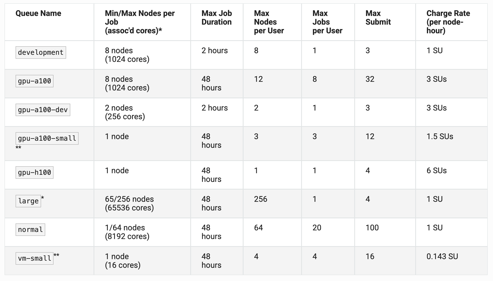

High Peformance Computing (HPC) 
===============================================

High Peformance Computing (HPC) refers to the aggregation of computing resources (i.e.
supercomputers or clusters) to achieve performance far greater than a single workstation or server.

Basic HPC System Architecture
-----------------------------

As you prepare to use TACC systems for your research, it is important to understand the basic
architecture. We can think of an HPC system as a very large and complicated laboratory instrument.

.. image:: ./images/hpc_schematic.png
   :target: ./images/hpc_schematic.png
   :alt: HPC System Architecture

To use a HPC cluster for scientific research, users need to learn how to:

* Interface with the cluster via command line
* Load samples (transfer data)
* Run experiments (submit batch jobs)

**IMPORTANT: Login vs. Compute Nodes**

An HPC system has login nodes and compute nodes. We cannot run applications on the **login nodes**
because they require too many resources and will interrupt the work of others. Instead, we must
submit a job to a queue to run on **compute nodes**.

Some Systems Available at TACC
------------------------------

Clusters
^^^^^^^^

* `Lonestar6 <https://tacc.utexas.edu/systems/lonestar6/>`_: Supporting Texas researchers in
  providing simulation, data analysis, visualization, and AI/machine learning.
* `Vista <https://tacc.utexas.edu/systems/vista/>`_: Vista expands TACC's capacity for AI and
  ensures that the broadscience, engineering, and education research communities have access to the
  most advanced computing and AI technologies.
* `Stampede3 <https://tacc.utexas.edu/systems/stampede3/>`_: The newest strategic resource advancing
  NSF's supercomputing ecosystem for the nation's open science community.

Storage Systems
^^^^^^^^^^^^^^^

* `Stockyard <https://tacc.utexas.edu/systems/stockyard/>`_: Global file system, it is accessible from all of TACC's systems. Capacity of 6,800 TB.
* `Corral <https://tacc.utexas.edu/systems/corral/>`_: Storage and data management system designed to support large-scale collections and a collaborative research environment. Capacity of 40,000 TB.
* `Ranch <https://tacc.utexas.edu/systems/ranch/>`_: Long-term data archiving system, high capacity (1,000,000 TB).

HPC terminology
----------------

On an HPC cluster, thousands of users run jobs simultaneously; therefore, the cluster is partitioned to accommodate jobs with varying priorities, hardware requirements, and execution times. To understand the organization of a cluster, it is useful to learn these concepts:

**Service Units (SUs)** are the unit of measure of compute time on a supercomputer. 1 SU = one node per one hour. Difference types of nodes may have different "charge rates". GPU nodes, for example, charge 3 SUs per hour, whereas a CPU node charge just 1 SU per hour. 

**Allocation**: An allocation is a "bundle" of SUs (node-hours) assigned to a user or a project. It is an approved budget of computing time that a project can use.  

**Reservation**: A reservation is a pre-arranged, guaranteed block of specific compute nodes set aside exclusively for a user during a designated timeframe, typically for special events like workshops, training, or live demonstrations.

**Queue**: A queue is a specific subdivision of a supercomputer's nodes, categorized by hardware type, time limit, or job size and priority, where users submit their computing jobs to be scheduled and executed.

  
Lonestar6 Queues
^^^^^^^^^^^^^^^^^^^^^^^^^^^^^^^^^^^^^^^

For example, these are the queues available on Lonestar 6. It is important to understand the queue limitations and pick a queue that is appropriate for your job. Documentation can be found `here <https://docs.tacc.utexas.edu/hpc/lonestar6/#table5>`_.

  

User Responsibility on Shared Resources
------------------------------------------------

HPC systems are shared resources. Your jobs and activity on a cluster, if mismanaged,
can affect others. TACC staff are always
`available to help <https://www.tacc.utexas.edu/about/help/>`_.

Tips for Success
^^^^^^^^^^^^^^^^

Read the `documentation <https://docs.tacc.utexas.edu/>`_.

* Learn node schematics, limitations, file systems, rules
* Learn about the scheduler, queues, policies
* Determine the right resource for the job

Additional Resources
--------------------

* `Lonestar6 documentation <https://docs.tacc.utexas.edu/hpc/lonestar6/>`_
* `TACC documentation <https://docs.tacc.utexas.edu/>`_
* `TACC help desk <https://www.tacc.utexas.edu/about/help>`_

