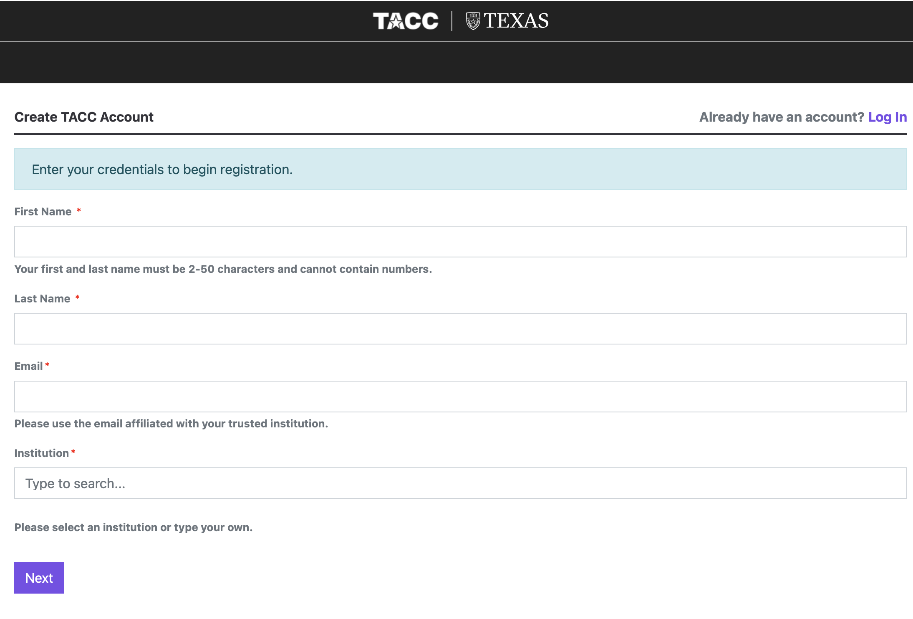

Connecting to the HPC cluster
==================================

In this section we will learn how to interact with a HPC cluster.

Create an Account
-----------------

To log in to TACC systems and participate in this workshop, you will need a TACC account. 
You can do this by visiting the `TACC registration <https://accounts.tacc.utexas.edu/register>`_:

|

Multi-factor authentication (MFA)  
^^^^^^^^^^^^^^^^^^^^^^^^^^^^^^^^^

 and must
have set up 
Once you have a TACC account, you need to set up multi-factor authentication using a token app or SMS.
The MFA is required to connect to the cluster via SSH. You can do this by visiting the
`TACC portal <https://tacc.utexas.edu/portal/login>`_:

.. image:: ./images/TACC_login.png
   :target: ./images/TACC_login.png
   :alt: TACC login page
   :width: 400px
   :align: center

|

Then clicking on your username at the top right of the page:

.. image:: ./images/TACC_dashboard.png
   :target: ./images/TACC_dashboard.png
   :alt: TACC Dashboard
   :width: 800px
   :align: center

|

And selecting "Manage Account", and, under MFA Pairing, clicking to pair:

.. image:: ./images/TACC_MFA_pairing.png
   :target: ./images/TACC_MFA_pairing.png
   :alt: TACC MFA pairing
   :width: 800px
   :align: center

You can find more details about MFA Pairing `here <https://docs.tacc.utexas.edu/basics/mfa/>`_.

.. tip::
   
   In your **TACC portal**, you can also view your allocations, open tickets, and the systems along
   with their current status.

Connecting to the Machines
--------------------------

This training will be fully interactive. Participants are **strongly encouraged** to follow along on
the command line. In this workshop, for commands on the local system we will use:

.. code-block:: console

   [local]$

And commands on remote systems will resemble:

.. code-block:: console

   [ls6]$ 

or:

.. code-block:: console

   [vista]$

Connecting to Lonestar6
^^^^^^^^^^^^^^^^^^^^^^^

To log in to Lonestar6, follow the instructions for your operating system below.

Linux / Mac (use Terminal) / Windows (use Termius)
~~~~~~~~~~~~~~~~~~~~~~~~~~~~~~~~~~~~~~~~~~~~~~~~~~~

Open the application 'Terminal' / 'Termius' and:

.. code-block:: console
   
   [local]$ ssh username@ls6.tacc.utexas.edu

   To access the system:
   
   1) If not using ssh-keys, please enter your TACC password at the password prompt
   2) At the TACC Token prompt, enter your 6-digit code followed by <return>.

   (enter password)
   (enter 6-digit token)

Successful Login to Lonestar6
~~~~~~~~~~~~~~~~~~~~~~~~~~~~~

If your login was successful, your terminal will look something like this:

.. code-block:: console 

   ------------------------------------------------------------------------------
   Welcome to the Lonestar6 Supercomputer
   Texas Advanced Computing Center, The University of Texas at Austin
   ------------------------------------------------------------------------------
   
   Unauthorized use/access is prohibited. **
   If you log on to this computer system, you acknowledge your awareness
   of and concurrence with the UT Austin Acceptable Use Policy. The
   University will prosecute violators to the full extent of the law.
   
   TACC Usage Policies:
   http://www.tacc.utexas.edu/user-services/usage-policies/
   ______________________________________________________________________
   
   Welcome to Lonestar6, please read these important system notes:
   
   --> Lonestar6 user documentation is available at:
   https://portal.tacc.utexas.edu/user-guides/lonestar6
   ---------------------- Project balances for user lconcia ----------------------
   | Name           Avail SUs     Expires | Name           Avail SUs     Expires |
   | TRA25008            5001  2030-11-30 | TACC-SCI            4253  2027-02-28 | 
   | MCB22058            2000  2026-11-30 |                                      |
   ------------------------ Disk quotas for user lconcia -------------------------
   | Disk         Usage (GB)     Limit    %Used   File Usage       Limit   %Used |
   | /scratch            0.0       0.0     0.00            0           0    0.00 |
   | /home1              1.0      10.0     9.57        27960           0    0.00 |
   | /work             878.6    1024.0    85.80      1307128     3000000   43.57 |
   -------------------------------------------------------------------------------

Coongratulations! You are now on a login node. From here, you can create, manipulate, and organize files and folders, write scripts, and launch jobs on the computation nodes.

A Note About Quotas
^^^^^^^^^^^^^^^^^^^

The welcome message you receive upon successful login to Lonestar6 has useful information
for you to keep track of. Especially of note is the breakdown of disk quotas for your account,
as you can keep an eye on whether your usage is nearing the determined limit. 

Once your usage is nearing the quota, you'll start to experience issues that will not only
impact your own work, but also impact the system for others. For example, if you're nearing
your quota in ``$WORK``, and your job is repeatedly trying (and failing) to write to ``$WORK``,
you will stress that file system.

.. tip::

   Another useful way to monitor your disk quotas (and TACC project balances) at any time is to
   execute:
   
   .. code-block:: console
   
      [ls6]$ /usr/local/etc/taccinfo

 
Additional Resources
--------------------

* `TACC account set up <https://tacc.utexas.edu/portal/login>`_
* `TACC documentation <https://docs.tacc.utexas.edu/>`_
* `TACC help desk <https://www.tacc.utexas.edu/about/help>`_
