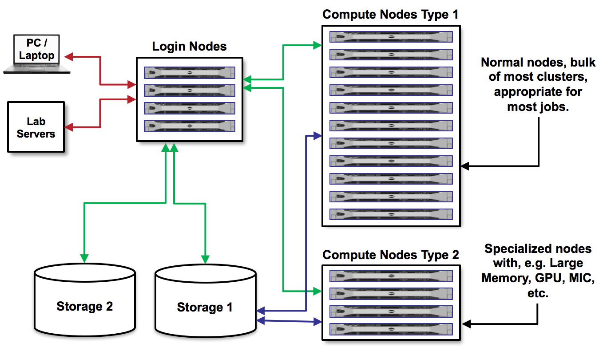

Running and monitoring jobs
===========================

As we discussed earlier, on a cluster there are login nodes and compute nodes. 
Jobs need to be run on the **computing nodes** .

There are two ways for running a job on a computing node:

* via an interactive session using the ``idev`` command, which is commonly used for development and troubleshooting
* by submitting batch jobs to a queue with the ``sbatch`` command, useful for production runs (e.g. training models at scale). 

Run Interactively with idev
---------------------------

The ``idev`` utility initiates an interactive session on one or more compute nodes so that you can
issue commands and run code as if you were doing so on your personal machine. An interactive session
is useful for development, as you can quickly compile, run, and validate code. This is accomplished
by simply executing ``idev`` on any of the TACC systems.

To learn about the command line options available for ``idev``, use ``idev -help``.

.. code-block:: console
   
   [ls6]$ idev --help
   ...
   OPTION ARGUMENTS         DESCRIPTION
   -A     account_name      sets allocation name or account name (default: in .idevrc)
   -m     minutes           sets time in minutes (default: 30)
   -p     queue_name        sets queue to named queue (default for idev: -p development)
   -r     reservation_name  requests use of a specific reservation
   -t     hh:mm:ss          sets time to hh:mm:ss (default: 00:30:00)
   -N     nodes             Number of nodes
   -help      [--help     ] displays (this) help message
   -v         [--version  ] output version information and exit

Let's go over some of the most useful ``idev`` command line options that can customize your
interactive session:

* To change the **time** limit from the default 30 minutes, users can apply the ``-m`` command line
  option. For example, a user requesting an interactive session for an hour would use the command
  line option ``-m 60``.
* To change the **allocation_name** associated with the interactive session, users can use the
  ``-A`` command line option. This option is useful for when a user has multiple allocations they
  belong to. For example, if I have allocations on accounts ``TACC`` and ``Training``, I can use
  ``-A`` to set the allocation I want to be used like so: ``-A TACC`` or ``-A Training``. 
* To change the **queue** to be different than the default ``development`` queue, users can use the
  ``-p`` command line option. For example, if a user wants to launch an interactive session on one
  of Lonestar6 GPU nodes, they would use the command line option ``-p gpu-a100`` or ``-p gpu-a100-dev``. You
  can learn more about the different queues of Lonestar6 
  `here <https://docs.tacc.utexas.edu/hpc/lonestar6/#table5>`_. The default queue for ``idev`` is the ``development`` queue which has a max runtime of 2 hours, and users can only submit one job at a time.
* To submit the interactive session to a specific **reservation**, users can use the ``-r`` command line option. This option is useful when a user needs to access dedicated nodes set aside for an event, workshop, or class.

.. note::
   
   For the scope of this training, we will be using the ``normal`` queue, the ``TRA25008`` allocation, and the ``UTRGV`` reservation.

To start a thirty-minute interactive session on a compute node with our parameters:

.. code-block:: console
   
   [ls6]$ idev -p normal -A TRA25008  -r UTRGV

If launch is successful, you will see output that includes the following excerpts:

.. code-block:: console
   
   ...
   -----------------------------------------------------------------
              Welcome to the Lonestar6 Supercomputer                
   -----------------------------------------------------------------
   
   No reservation for this job
   --> Verifying valid submit host (login2)...OK
   --> Verifying valid jobname...OK
   --> Verifying valid ssh keys...OK
   --> Verifying access to desired queue (development)...OK
   --> Checking available allocation (TRA25008)...OK
   --> Verifying that quota for filesystem /home1/03302/lconcia is at 10.51% allocated...OK
   --> Verifying that quota for filesystem /work/03302/lconcia/ls6 is at 85.81% allocated...OK
   Submitted batch job 3559849

     -> After your idev job begins to run, a command prompt will appear,
     -> and you can begin your interactive development session. 
     -> Waiting for idev job to Run (change from PD=pending to R=running).
    
            Job  Wait
           State (m:s)
            R    0:23
    
     -> Job is now running on masternode= c313-213...OK
     -> Checking for an environment file in master node.... FOUND
     ->          Time Waited for env file: 2 (sec)
     -> Creating interactive terminal session    on master node c313-213.
     -> Node access by: ssh -Y -A -o "StrictHostKeyChecking no" c313-213
     
    c313-213.ls6(1000)$ 

EXERCISE
^^^^^^^^

.. note::

   In case you didn't donwload the code in the previous section, you can download by doing:
   
   .. code-block:: console
   
      [ls6]$ cdw
      [ls6]$ cp /work/03302/lconcia/public/UTRGV_tutorial.zip .

   or

   .. code-block:: console
   
      [ls6]$ cdw
      [ls6]$ wget https://github.com/lconcia/tacc-training-utrgv/raw/refs/heads/main/docs/section1/files/UTRGV_tutorial.zip

As an exercise, we will now run some code in our open ``idev`` session.
We will execute some Python code that determines the larger of two numbers. The code also includes a
3-second delay before finishing. Note, the ``[c313-213.ls6]`` syntax in the prompt refers to an interactive
session that has been started on a Lonestar6 node. Each of you will see a different node number.

.. code-block:: console

   [ls6]$ cdw
   [ls6]$ unzip UTRGV_tutorial.zip
   [ls6]$ cd UTRGV_tutorial/Lab02
   [ls6]$ pwd
   /work/03302/lconcia/ls6/UTRGV_tutorial/Lab02
   [ls6]$ ls
   example.slurm  example_template.slurm  my_code.py

Load the appropriate modules, and run ``my_code.py``. 

.. code-block:: console

   [ls6]$ module load python3
   [ls6]$ python3 my_code.py
   The larger number of 51 and 20 is 51

You can check the files that were generated using ``ls``, and see the contents of the file with
``cat``.

.. code-block:: console

   [clx]$ ls
   duration.txt  example.slurm  example_template.slurm  my_code.py
   [clx]$ cat duration.txt
   Done in 3.009739637374878 seconds.

To exit an interactive session, you can use the command ``logout``.

Run Non-Interactively with sbatch
---------------------------------

To run non-interactively a job on the computation nodes, we need to write a short text file containing a list of the resources we need, and containing the command(s) for running the application. Then, we submit that text file to a queue to run on compute nodes. This process is called **batch job submission**.

Let's check the elements of a ``sbatch`` job submission submission file.
First, navigate to the ``Lab01`` directory where we have an example job script prepared, called
``example_template.slurm``:

.. code-block:: console

   [ls6]$ cdw
   [ls6]$ cd Lab01
   [ls6]$ cat example_template.slurm

   #!/bin/bash
   #----------------------------------------------------
   # Example SLURM job script to run applications on 
   # TACCs Lonestar6 system.
   #
   # Example of job submission
   # To submit a batch job, execute:             sbatch example.slurm
   # To show all queued jobs from user, execute: showq -u
   # To kill a queued job, execute:              scancel <jobId>
   #----------------------------------------------------

   #SBATCH -J                                  # Job name
   #SBATCH -o                                  # Name of stdout output file (%j expands to jobId)
   #SBATCH -e                                  # Name of stderr error file (%j expands to jobId)
   #SBATCH -p                                  # Queue (partition) name
   #SBATCH -N                                  # Total number of nodes (must be 1 for serial)
   #SBATCH -n                                  # Total number of threas tasks requested (should be 1 for serial)
   #SBATCH -t                                  # Run time (hh:mm:ss), development queue max 2:00:00
   #SBATCH --mail-user=your_email@domaim.com   # Address email notifications
   #SBATCH --mail-type=all                     # Email at begin and end of job
   #SBATCH -A                                  # Project/Allocation name (req'd if you have more than 1)
   #SBATCH -r                                  # Reservation

   # Everything below here should be Linux commands

 

.. note:: 

   The template job.slurm file above is incomplete. It will not work without filling in values for
   each of the SLURM directives.

EXERCISE
^^^^^^^^

We will now run the same Python code as before, but using a batch job submission.

.. code-block:: console

   [ls6]$ cdw
   [ls6]$ cd Lab01
   [ls6]$ pwd
   /work2/03302/lconcia/ls6/Lab01
   [ls6]$ ls
   example.slurm  example_template.slurm  my_code.py

Write the SLURM Script 
~~~~~~~~~~~~~~~~~~~~~~

Next, we need to fill out ``example_template.slurm`` to request the necessary resources. I know that
this code will take a little more than 3 seconds, so I can reasonably predict how much we will need. 
When running your first jobs with your applications, it will take some trial and error, and reading
online documentation, to get a feel for how many resources you should use. Open ``example_template.slurm``
with Nano and fill out the following information:

.. code-block:: console

   #!/bin/bash
   #----------------------------------------------------
   # Example SLURM job script to run applications on 
   # TACCs Lonestar6 system.
   #
   # Example of job submission
   # To submit a batch job, execute:             sbatch example.slurm
   # To show all queued jobs from user, execute: showq -u
   # To kill a queued job, execute:              scancel <jobId>
   #----------------------------------------------------

   #SBATCH -J first_job                    # Job name
   #SBATCH -o output.%j                    # Name of stdout output file (%j expands to jobId)
   #SBATCH -e error.%j                     # Name of stderr error file (%j expands to jobId)
   #SBATCH -p normal                       # Queue (partition) name
   #SBATCH -N 1                            # Total number of nodes (must be 1 for serial)
   #SBATCH -n 1                            # Total number of threas tasks requested (should be 1 for serial)
   #SBATCH -t 0:30:00                      # Run time (hh:mm:ss), development queue max 2:00:00
   #SBATCH -A TRA25008                     # Project/Allocation name (req'd if you have more than 1)
   #SBATCH -r UTRGV                        # Reservation  

   # Everything below here should be Linux commands

   module load python3

   python3 my_code.py

The way this job is configured, it will load the appropriate modules, and run ``my_code.py``. 

.. note:: 

   After editing the file with Nano, you can save it with ``Ctrl-o`` and close it with  ``Ctrl-x``. 

Submit a Batch Job to the Queue
^^^^^^^^^^^^^^^^^^^^^^^^^^^^^^^

Once you have filled in the job description, save and quit the file. Submit the job to the queue
using the ``sbatch`` command`:

.. code-block:: console

   [ls6]$ sbatch example_template.slurm

Executing Basic Job Management Tasks
^^^^^^^^^^^^^^^^^^^^^^^^^^^^^^^^^^^^
To view the jobs you have currently in the queue, use the ``showq`` or ``squeue`` commands:

.. code-block:: console

   [ls6]$ showq -u               # shows my jobs
   [ls6]$ showq                  # shows all jobs by all users
   [ls6]$ squeue -u $USERNAME    # shows my jobs
   [ls6]$ squeue                 # shows all jobs by all users

If for any reason you need to cancel a job, use the ``scancel`` command with the 6- or 7-digit
``jobid``:

.. code-block:: console

   [ls6]$ scancel jobid

If everything went well, you should have a file named ``duration.txt``, 
an output file named something similar to ``output.o6146935``, 
and an error file named something similar to ``error.o6146935`` in the same directory as the
``example_template.slurm`` script. 

.. code-block:: console

   [ls6]$ ls
   duration.txt  error.6146935  example.slurm  example_template.slurm  my_code.py  output.6146935

**Congratulations! You ran a batch job on Lonestar6!**

 
Review of Topics Covered
------------------------
 
**SLURM**

+------------------------------------+-------------------------------------------------+
| Command                            |  Effect                                         |
+====================================+=================================================+
| ``sbatch JOB.SLURM``               |  submit batch job to the queue                  |
+------------------------------------+-------------------------------------------------+
| ``showq``                          |  show all jobs by all users                     |
+------------------------------------+-------------------------------------------------+
| ``showq -u``                       |  show the current user's jobs                   |
+------------------------------------+-------------------------------------------------+
| ``squeue``                         |  show all jobs by all users                     |
+------------------------------------+-------------------------------------------------+
| ``squeue -u USERNAME``             |  show user USERNAME's jobs                      |
+------------------------------------+-------------------------------------------------+
| ``scancel JOBID``                  |  cancel a job given a job ID                    |
+------------------------------------+-------------------------------------------------+
 

Additional Resources
--------------------

* `SLURM documentation <https://slurm.schedmd.com/documentation.html>`_
